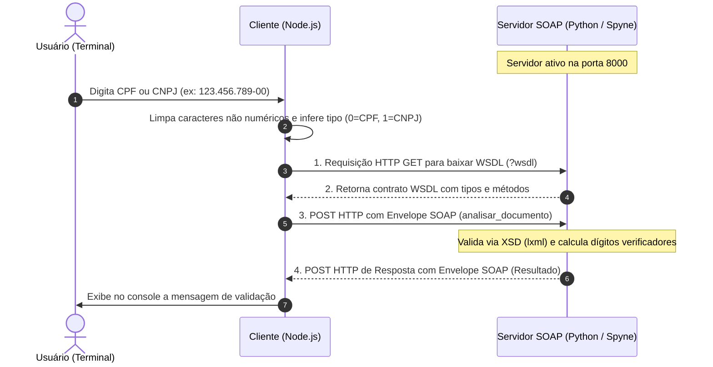

# Web Services com SOAP e XML — Validador de Documentos (CPF / CNPJ)

Este projeto implementa uma arquitetura distribuída de **Web Service** baseada no protocolo **SOAP** (*Simple Object Access Protocol*) e formato **XML**, desenvolvida para a disciplina de **Sistemas Distribuídos (PEPSDIS)** do curso de **Bacharelado em Ciência da Computação** do **IFSP — Câmpus Presidente Epitácio**.

O sistema demonstra a interoperabilidade e a heterogeneidade típicas de sistemas distribuídos modernos: um **servidor SOAP escrito em Python** publica uma interface de serviço descrita formalmente em **WSDL**, que é consumida por um **cliente escrito em Node.js (JavaScript)**.

---

## 📌 Contexto Acadêmico

* **Instituição:** Instituto Federal de São Paulo (IFSP) — Câmpus Presidente Epitácio
* **Curso:** Bacharelado em Ciência da Computação
* **Disciplina:** Sistemas Distribuídos (Código: `PEPSDIS` - Semestre 6)
* **Unidade:** Unidade 09 — Serviços Web (Arquiteturas SOAP, WSDL e XML/XSD)
* **Tema:** Invocação Remota de Procedimentos (RPC) com contratos formais heterogêneos

---

## 🏛️ Arquitetura da Solução

O sistema é dividido em duas partes independentes e desacopladas que se comunicam através da rede via protocolo HTTP transportando envelopes SOAP/XML:



### 1. Servidor SOAP (`Servidor.py` - Python)
* Desenvolvido com o framework **Spyne** e servidor **WSGI** (`wsgiref.simple_server`).
* Expõe o serviço `ValidadorDocumento` no namespace (`tns`) `analisador.service`.
* Gera e serve dinamicamente o contrato **WSDL** (*Web Services Description Language*) em `http://localhost:8000/?wsdl`.
* Valida as mensagens de entrada contra esquemas **XSD** utilizando a biblioteca `lxml` (`Soap11(validator='lxml')`).
* Executa o cálculo algorítmico oficial dos dígitos verificadores (módulo 11) para CPF e CNPJ.

### 2. Cliente SOAP (`Cliente.js` - Node.js)
* Desenvolvido em **JavaScript / Node.js** utilizando o módulo oficial `soap`.
* Lê a entrada do usuário pelo terminal via `readline/promises`.
* Sanitiza o texto de entrada (remove pontos, traços e barras via expressão regular `/\D/g`).
* Identifica automaticamente a categoria do documento com base no comprimento:
  * 11 dígitos $	o$ Tipo `0` (CPF)
  * 14 dígitos $	o$ Tipo `1` (CNPJ)
  * Qualquer outro tamanho $	o$ Tipo `-1` (Inválido)
* Carrega assincronamente o WSDL do servidor e invoca a operação remota `analisar_documentoAsync({ tipo, doc })`.

---

## 📂 Estrutura de Arquivos

```text
SOAP-XML/
└── Validador-XML/
    ├── Servidor.py      # Servidor SOAP RPC em Python (porta 8000)
    ├── Cliente.js       # Cliente consumidor em Node.js (console interativo)
    ├── venv/            # Ambiente virtual Python com dependências (spyne, lxml)
    └── README.md        # Documentação detalhada da prática
```

---

## ⚙️ Tecnologias e Bibliotecas

| Componente | Tecnologia | Papel no Sistema Distribuído |
| :--- | :--- | :--- |
| **Back-end Server** | **Python 3.12** | Implementação do serviço web e lógica matemática |
| **SOAP Framework** | **Spyne 2.15** | Construção do serviço SOAP, geração automática de WSDL e binding RPC |
| **Validador XML** | **lxml 6.1** | Validação estrutural de mensagens SOAP com esquemas XSD |
| **Servidor HTTP** | **WSGI (`wsgiref`)** | Servidor de aplicação HTTP na porta 8000 |
| **Cliente Web** | **Node.js (v22+)** | Consumidor do Web Service via terminal |
| **SOAP Client** | **`soap` (npm)** | Cliente SOAP que faz parse do WSDL e gera chamadas RPC dinâmicas |
| **I/O Assíncrono** | **`readline/promises`**| Captura interativa de dados de teclado no terminal |

---

## 📐 Regras de Validação Implementadas

O servidor implementa o cálculo oficial com pesos e módulo 11 conforme a legislação brasileira:

### 1. Validação de CPF (11 dígitos)
* Rejeita números com quantidade diferente de 11 dígitos ou que contenham apenas dígitos idênticos repetidos (ex.: `111.111.111-11`).
* **1º Dígito Verificador:** Soma ponderada dos primeiros 9 dígitos com pesos decrescentes de 10 a 2. Resto: `(soma * 10 % 11) % 10`.
* **2º Dígito Verificador:** Soma ponderada dos primeiros 10 dígitos com pesos decrescentes de 11 a 2. Resto: `(soma * 10 % 11) % 10`.

### 2. Validação de CNPJ (14 dígitos)
* Rejeita números com quantidade diferente de 14 dígitos ou repetidos (ex.: `000...000`).
* **1º Dígito Verificador:** Pesos `[5, 4, 3, 2, 9, 8, 7, 6, 5, 4, 3, 2]` aplicados aos primeiros 12 dígitos. Resto: `soma % 11`. Se resto $< 2$, dígito = 0; caso contrário, `11 - resto`.
* **2º Dígito Verificador:** Pesos `[6, 5, 4, 3, 2, 9, 8, 7, 6, 5, 4, 3, 2]` aplicados aos primeiros 13 dígitos.

---

## 🚀 Como Executar o Projeto

### Pré-requisitos
* Python 3.10+ instalado
* Node.js v18+ e npm instalados

---

### Passo 1: Iniciar o Servidor SOAP (Python)

Abra um terminal, navegue até a pasta do validador e ative o ambiente virtual já configurado:

```bash
cd "/home/guilherme/Documentos/01_Faculdade/Matérias/Semestre 6/SDIS/SOAP-XML/Validador-XML"

# Ativar o ambiente virtual (venv)
source venv/bin/activate

# Iniciar o servidor SOAP
python3 Servidor.py
```

Você verá a saída indicando que o servidor está rodando:
```text
======= Servidor SOAP iniciado na porta 8000 =======
WSDL disponível em: http://localhost:8000/?wsdl
```

> **Dica:** Você pode abrir a URL `http://localhost:8000/?wsdl` no seu navegador web para visualizar o contrato XML/WSDL gerado automaticamente pelo Spyne.

---

### Passo 2: Executar o Cliente (Node.js)

Em outro terminal (mantenha o servidor aberto):

```bash
cd "/home/guilherme/Documentos/01_Faculdade/Matérias/Semestre 6/SDIS/SOAP-XML/Validador-XML"

# Executar o cliente Node.js
node Cliente.js
```

O cliente solicitará o documento:
```text
Digite seu CPF ou CNPJ: 123.456.789-09

Resposta do Servidor Analisar documento

CPF válido e dentro do padrão XSD!
```

---

## 🔍 Exemplo de Mensagens SOAP Trocadas (Sob o Capô)

### Requisição SOAP (Cliente $	o$ Servidor)
```xml
<?xml version="1.0" encoding="utf-8"?>
<soap:Envelope xmlns:soap="http://schemas.xmlsoap.org/soap/envelope/"
               xmlns:tns="analisador.service">
  <soap:Body>
    <tns:analisar_documento>
      <tns:tipo>0</tns:tipo>
      <tns:doc>12345678909</tns:doc>
    </tns:analisar_documento>
  </soap:Body>
</soap:Envelope>
```

### Resposta SOAP (Servidor $	o$ Cliente)
```xml
<?xml version="1.0" encoding="utf-8"?>
<soap:Envelope xmlns:soap="http://schemas.xmlsoap.org/soap/envelope/"
               xmlns:tns="analisador.service">
  <soap:Body>
    <tns:analisar_documentoResponse>
      <tns:analisar_documentoResult>CPF válido e dentro do padrão XSD!</tns:analisar_documentoResult>
    </tns:analisar_documentoResponse>
  </soap:Body>
</soap:Envelope>
```

---

## 💡 Conceitos de Sistemas Distribuídos em Destaque

1. **Heterogeneidade de Plataformas:**
   O cliente (Node.js/V8/JavaScript) e o servidor (Python/CPython) rodam em runtimes completamente diferentes, mas interoperam perfeitamente sem necessidade de adaptadores manuais proprietários.
2. **Definição Formal de Contrato (WSDL):**
   A especificação WSDL descreve as operações disponíveis, parâmetros de entrada/saída e tipos de dados de forma padronizada mundialmente pelo W3C.
3. **Validação de Esquemas (XML / XSD):**
   O uso de `Soap11(validator='lxml')` no servidor garante que apenas mensagens formatadas rigorosamente de acordo com as especificações do XSD sejam aceitas e processadas.
4. **Transparência de Acesso (RPC):**
   Para o código do cliente JavaScript, a função remota é invocada quase como se fosse uma função local (`client.analisar_documentoAsync(dados)`), abstraindo detalhes de sockets e serialização HTTP.
